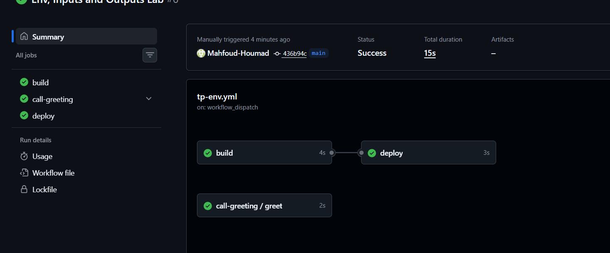

# TP 6 : Variables d'environnement, Inputs et Outputs

## Réponses aux questions

### Q1. Pourquoi la variable n'est-elle pas disponible dans la step qui l'a définie, mais seulement dans les suivantes ?
Dans GitHub Actions, chaque `step` s'exécute dans son propre sous-processus shell. Lorsqu'une commande écrit dans `$GITHUB_ENV`, le runner ne lit et n'injecte les nouvelles variables dans l'environnement du job **qu'à la fin de la step en cours**. Le processus actuel n'en a donc pas encore connaissance ; seules les steps suivantes les reçoivent.

### Q2. Ajoutez un second job `verify-env` avec une step `Print APP_NAME` et tentez d'y afficher `$APP_NAME`. Que constatez-vous ? Quelle est donc la portée de `GITHUB_ENV` ?
* `$APP_NAME` est vide.
* La portée de `GITHUB_ENV` est strictement limitée au **job** (à la machine virtuelle du runner qui l'exécute). Chaque job démarrant sur un environnement isolé, les variables de `GITHUB_ENV` ne traversent pas d'un job à l'autre.

### Q3. Que se passe-t-il si vous écrivez `>` au lieu de `>>` dans `GITHUB_OUTPUT` alors que deux outputs sont définis dans la même step ?
En Bash, `>` écrase entièrement le fichier cible alors que `>>` ajoute à la fin (*append*). Si on utilise `>` pour le deuxième output dans la même step, le premier output déjà écrit dans `$GITHUB_OUTPUT` est effacé et perdu (sa valeur sera vide).

### Q4. Pourquoi `GITHUB_ENV` ne suffit-il pas ici, alors que `GITHUB_OUTPUT` fonctionne entre jobs ?
`GITHUB_ENV` modifie uniquement l'environnement local de la machine virtuelle d'un job, qui est détruite à la fin de son exécution. À l'inverse, `GITHUB_OUTPUT` remonte les valeurs au moteur d'orchestration de GitHub Actions. En les exposant via `jobs.<job_id>.outputs`, les jobs suivants peuvent les récupérer via le contexte `needs` sur d'autres machines virtuelles.

### Q5. Que se passe-t-il si vous retirez `needs: build` du job `deploy` ?
Deux conséquences :
1. **Exécution parallèle :** `build` et `deploy` démarrent en même temps au lieu de s'exécuter séquentiellement.
2. **Donnée vide :** L'expression `${{ needs.build.outputs.full_version }}` s'évalue à une chaîne vide car `deploy` n'a plus de dépendance déclarée envers `build` et s'exécute avant que `full_version` ne soit calculée.

---

## Preuve d'exécution

