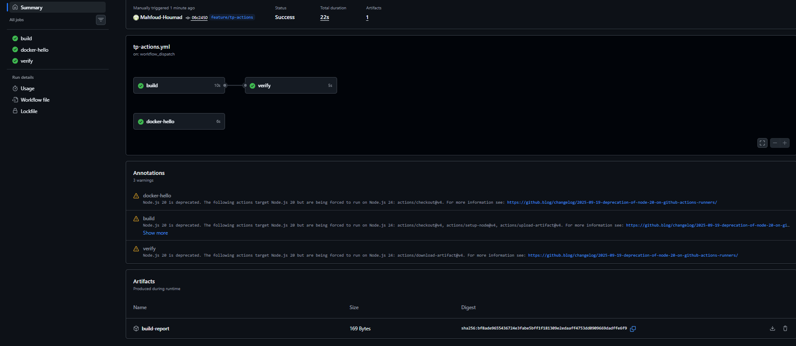

# TP 7 : Actions tierces et actions personnalisées

## Réponses aux questions

### Q1. Pourquoi `actions/checkout` n'a-t-il pas besoin de `with` alors que `setup-node` en a besoin ?
`actions/checkout` fonctionne avec des valeurs par défaut pertinentes (il clone automatiquement le dépôt courant sur le commit qui a déclenché le workflow), ses paramètres `with` sont donc optionnels. À l'inverse, `actions/setup-node` a besoin de savoir quelle version précise de Node.js installer (ou quel fichier de version lire) pour configurer l'environnement attendu par le projet.

### Q2. Pourquoi le job `verify` ne retrouve-t-il pas `report.txt` sans l'artefact, alors que les deux jobs partagent le même dépôt ?
Dans GitHub Actions, chaque job s'exécute sur une **machine virtuelle (runner) complètement isolée**. Le fichier `report.txt` est généré dynamiquement sur le disque local du runner du job `build` (il n'est pas commité dans le dépôt Git). Lorsque `build` se termine, sa VM est détruite ; sans passer par le stockage intermédiaire des artefacts (`upload-artifact` / `download-artifact`), `verify` ne peut pas accéder au système de fichiers d'un autre runner.

### Q6. Pourquoi `actions/checkout` doit-il s'exécuter avant l'appel d'une action locale ?
Comme le runner démarre avec un espace de travail vide, il faut obligatoirement exécuter `actions/checkout` au préalable pour cloner le dépôt sur le disque du runner et rendre le fichier `action.yml` accessible.

### Q7. Pourquoi `shell: bash` est-il obligatoire sur les steps `run` d'une action composite ?
Contrairement à un workflow classique où GitHub Actions applique un shell par défaut selon l'OS du runner, une action composite est conçue pour être agnostique et potentiellement multiplateforme. GitHub impose donc de déclarer explicitement `shell:` sur chaque step `run` afin d'éviter toute ambiguïté d'exécution quel que soit l'environnement appelant.

---

## Comparaison des temps d'exécution (Partie 4 : Composite vs Docker)
* **Action composite (`build-info`) :** Exécution quasi instantanée, car les commandes `bash` s'exécutent directement sur le runner hôte déjà démarré, sans surcoût d'initialisation.
* **Action Docker (`docker-hello`) :** Exécution nettement plus longue (~6 secondes au total pour le job), car GitHub Actions doit d'abord télécharger l'image de base (`alpine:3.20`), construire l'image Docker à partir du `Dockerfile`, puis instancier le conteneur avant d'exécuter le script.

---

## Preuve d'exécution

